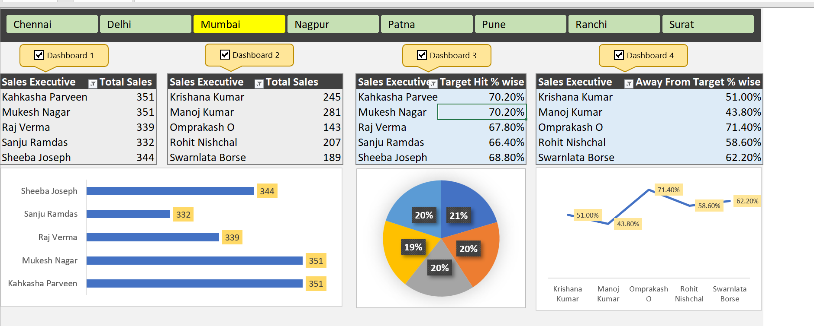
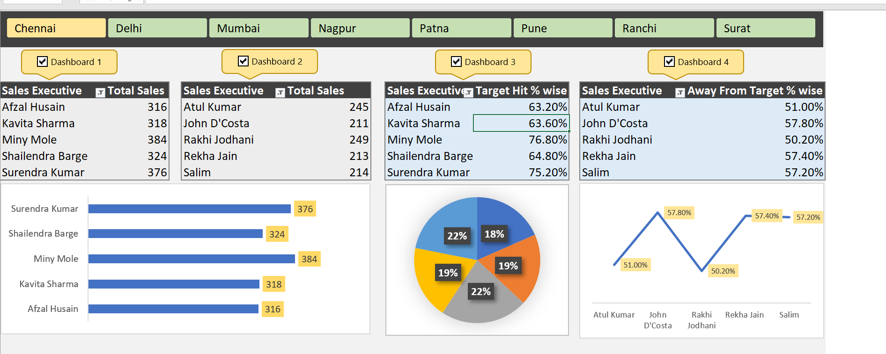
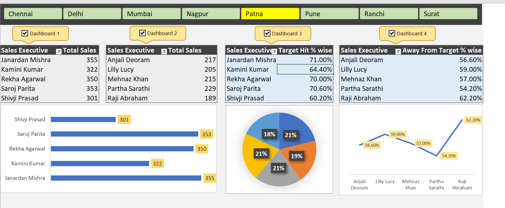

# Excel Sales Performance Dashboard

An interactive Microsoft Excel dashboard for analyzing sales performance across multiple cities and sales executives.

## Dashboard Previews

### Chennai Dashboard

### Mumbai Dashboard

### Patna Dashboard

## Download the Dashboard

Download and open [Sales-Performance.xlsm](Sales-Performance.xlsm) in Microsoft Excel. Enable workbook content if prompted to activate the interactive features.

## Project Overview

This project presents sales information in a visual dashboard to make it easier to monitor sales executive performance, compare results, and understand target achievement across different city selections.

## Dashboard Features

- **City-wise filtering:** View dashboard data for Chennai, Delhi, Mumbai, Nagpur, Patna, Pune, Ranchi, and Surat.
- **Sales executive performance:** Compare total sales by individual sales executives.
- **Target achievement:** Review target-hit percentages for sales executives.
- **Away-from-target analysis:** Identify how far each executive is from the sales target.
- **Visual charts:** Includes horizontal bar charts, a pie chart, and a line chart.
- **Multiple dashboard sections:** Four dashboard sections present different sales performance measures.

## Tools Used

- Microsoft Excel
- Excel tables and filters
- Charts and data visualization

## Project Purpose

The purpose of this project is to present sales data in a clear, interactive, and easy-to-understand format that helps users compare sales performance across cities and executives.
